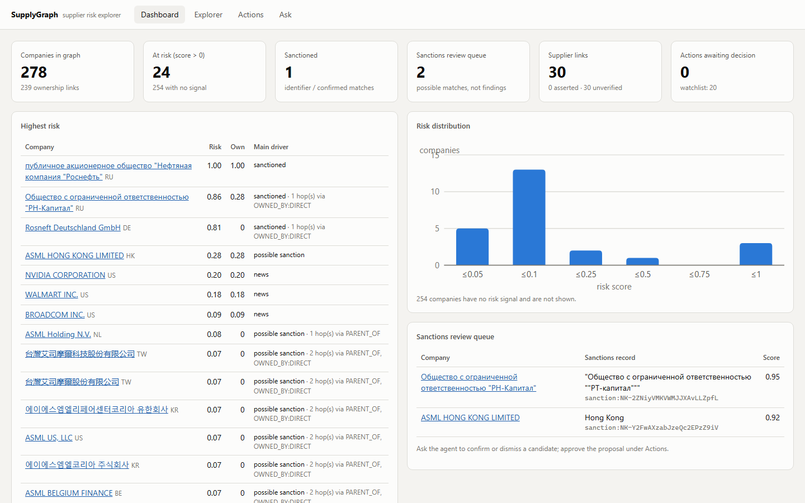
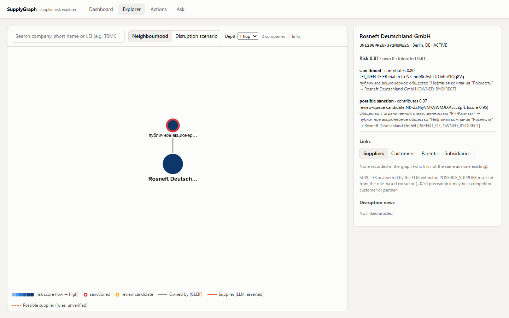
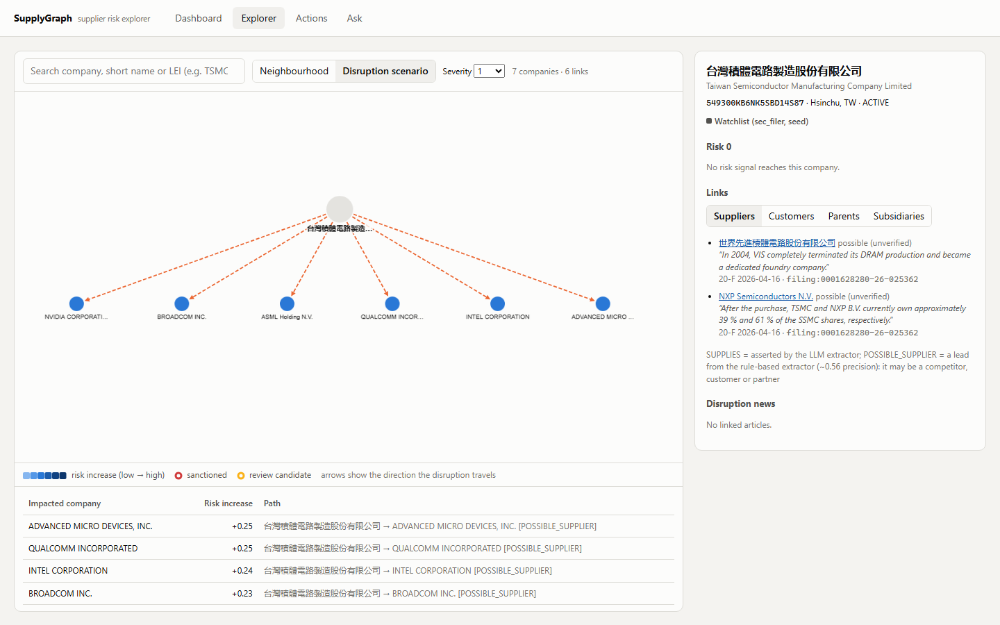

# Five-minute demo

The demo runs on a committed snapshot of real data (GLEIF, OpenSanctions, SEC filings, GDELT;
278 companies), so it needs no network, API keys or pipeline run.

```powershell
# from source
pip install -e ".[dev]"; cd web; npm install; npm run build; cd ..
supplygraph demo-data          # refuses to overwrite an existing warehouse (--force to replace)
supplygraph serve              # http://127.0.0.1:8000

# or with Docker
docker build -t supplygraph:0.8.0 .
docker run --rm -v sgdemo:/data supplygraph:0.8.0 demo-data
docker run --rm -p 127.0.0.1:8000:8000 -v sgdemo:/data supplygraph:0.8.0
```

## 1. Where is the risk? (Dashboard)



24 of 278 companies carry a risk signal. Three are the story:
- the sanctioned Rosneft parent (matched by LEI, confidence 1.0);
- its two subsidiaries, which inherit risk through ownership, as under OFAC's 50 % rule.

The **review queue** holds two *possible* sanctions matches. These are leads, not findings. One
of them, "ASML HONG KONG LIMITED" against a North Korea-linked trading company, matched only on
the alias "Hong Kong".

## 2. Why is this company risky? (Explorer)



Rosneft Deutschland GmbH scores **0.81 with zero risk of its own**. The panel shows the full
explanation:
- the signal: an LEI match to sanctions record `NK-nq68…`;
- the source: the Russian parent;
- the path: one `OWNED_BY:DIRECT` hop at weight 0.8.

Every non-zero score in the graph has such a path; a quality check enforces it.

## 3. What if a supplier goes down? (Scenario)

Open TSMC, then click **Disruption scenario** (or go to `#/company/549300KB6NK5SBD14S87/scenario`).



Six companies' risk rises. Each one is a customer whose annual report names TSMC near a supply
cue. The links are dashed: they come from the rule extractor (`POSSIBLE_SUPPLIER`, 0.56
precision), so they transmit at half the weight of an asserted link. Intel, for example, calls
TSMC both a foundry supplier and a competitor, and the UI shows the evidence sentence and filing
for each link so an analyst can check it.

## 4. Act on it, safely (Actions and Ask)

With Claude API credit, **Ask**: *"The ASML Hong Kong sanctions candidate only matched the
alias 'Hong Kong' — dismiss it."* The agent:
1. looks up the candidate and the sanctions record;
2. answers with citations;
3. records a **proposal**. Nothing changes yet.

Under **Actions** an analyst approves it. The decision goes into the append-only audit log, and
the next `resolve` applies it. On the live data that removes the spurious risk from the whole
ASML group (companies at risk: 24 → 7). The same flow works without the agent:
`supplygraph actions approve|reject` decides proposals from the CLI.

## 5. Operate it (Kubernetes)

```powershell
helm install sg deploy/helm/supplygraph -n supplygraph --create-namespace --set api.token.value=<token>
helm test sg -n supplygraph
kubectl -n supplygraph create job --from=cronjob/sg-supplygraph-pipeline pipeline-manual
```

- A fresh install serves this snapshot until the nightly pipeline publishes real data. The
  pipeline publishes only if the quality gate passes.
- `/metrics` reports how old the data is, and an alert fires if it goes stale.
- See [deploy/README.md](../deploy/README.md) and the decision records in [adr/](adr/).
